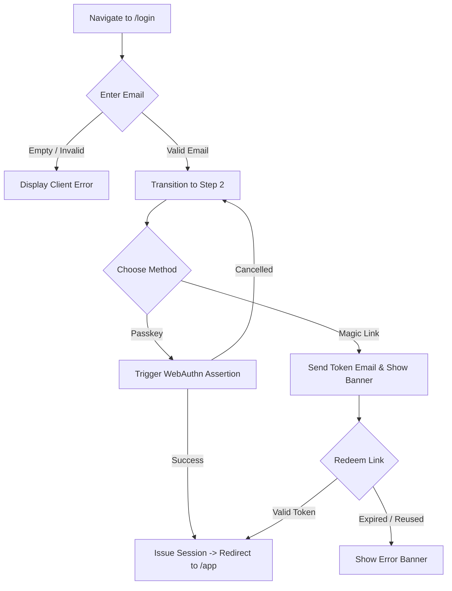

# Requirement to Test Analysis: Login Feature

**Specification Source**: [login.md](file:///Users/expattest01/Projects/PayReview/requirements/login.md)  
**Workflow**: `requirement-to-test`  
**Governing Rules**:
- [payreview-global.md](file:///Users/expattest01/Projects/PayReview/.agent/rules/payreview-global.md)
- [requirements-analysis.md](file:///Users/expattest01/Projects/PayReview/.agent/rules/requirements-analysis.md)
- [security-access-control.md](file:///Users/expattest01/Projects/PayReview/.agent/rules/security-access-control.md)
- [testing-rules.md](file:///Users/expattest01/Projects/PayReview/.agent/rules/testing-rules.md)

---

## 1. Requirement Analysis

### 1.1 Actors & Role Mapping
| Actor | Responsibility & Permissions | Post-Login Target | Compensation Data Scope |
| :--- | :--- | :--- | :--- |
| **HR Admin** | Full cycle management, company-wide configuration | `/app` | Company-wide unrestricted access |
| **Line Manager** | Merit recommendations for team members | `/app` | Direct & indirect reporting tree only |
| **Employee** | View finalized compensation statements | `/app` | Personal finalized records only |
| **Unauthenticated User** | Anonymous visitor | Intercepted → `/login` | Denied |

### 1.2 Preconditions
- PayReview frontend application is accessible at `/login`.
- Registered test users exist in the database for each role (`HR Admin`, `Line Manager`, `Employee`).
- WebAuthn / Passkey credentials registered for passkey test cases.
- Outbound email delivery or email mock service configured to intercept magic link tokens.
- Clean browser context (no active session cookies or cached tokens).

### 1.3 Business Rules & Validations
1. **Two-Step Progressive Disclosure**:
   - **Step 1**: Email input field must be validated for presence and valid RFC 5322 format before progressing.
   - **Step 2**: Display the validated email and present **"Sign in with Passkey"** and **"Sign in with Magic Link"** buttons.
2. **Passkey Authentication (WebAuthn)**:
   - Initiates browser biometric/FIDO2 authenticator assertion challenge.
   - On valid assertion verification, issues session cookie/JWT and redirects to `/app`.
3. **Magic Link Authentication**:
   - Generates cryptographically secure, time-limited, single-use token.
   - Sends email containing link: `/auth/verify?token=<token>`.
   - UI confirms dispatch and provides a resend action guarded by cooldown timer (e.g., 60 seconds).
   - Once clicked, token is validated, invalidated against reuse, and redirects user to `/app`.
4. **Deep Linking (`returnUrl`)**:
   - Unauthenticated attempts to access `/app/*` store the original destination in `?returnUrl=...`.
   - Following successful Passkey or Magic Link authentication, user is redirected to the `returnUrl` destination.
5. **Session & Security Protections**:
   - Session tokens must use `HttpOnly`, `SameSite=Lax/Strict`, and `Secure` attributes.
   - Logged-out users navigating backwards in browser history must not access cached `/app` views.

---

## 2. Risk Assessment

| Priority | Risk Category | Failure Scenario | Impact | Test Focus |
| :--- | :--- | :--- | :--- | :--- |
| **High** | **Authentication Bypass** | Unauthenticated user directly accessing `/app/*` | Critical data leak | Route guard and token verification tests |
| **High** | **Token Replay / Hijack** | Reusing a consumed or expired magic link | Account takeover | Token single-use and expiration enforcement |
| **High** | **Passkey Failure Hang** | Cancellation of WebAuthn leaves UI unresponsive | Blocked login | Fallback and cancellation handling |
| **Medium** | **Email Flooding** | Repeatedly triggering "Send Magic Link" | Service abuse & spam | Cooldown and rate limiting checks |
| **Medium** | **Deep Link Traversal** | Malicious external redirect in `returnUrl` | Phishing attack | Internal path sanitization |
| **Low** | **UI Glitches** | Form autofocus, tab order, button styling | Usability defect | Keyboard and focus testing |

---

## 3. Test Scenarios Matrix

### Scenario Categories
- **Happy Path**: Step 1 validation → Passkey login / Magic link login → Redirection to `/app`.
- **Alternate Paths**: Deep linking with `returnUrl`, user cancels Passkey and selects Magic Link, resend Magic Link after cooldown.
- **Negative Paths**: Blank email, malformed email, unregistered email, expired token, reused token.
- **Security & Authorization**: Unauthenticated direct URL navigation, session invalidation on logout, open redirect prevention.

---

## 4. Test Cases

### TC-LOGIN-001: Step 1 - Submit Valid Registered Email (Happy Path)
- **Objective**: Verify that submitting a valid registered email transitions the user to Step 2.
- **Preconditions**: User `hr.admin@payreview.local` is registered.
- **Steps**:
  1. Open browser and navigate to `/login`.
  2. Enter `hr.admin@payreview.local` in the Email field.
  3. Click "Continue" (or press `Enter`).
- **Expected Result**:
  - Step 1 completes.
  - Step 2 UI is displayed showing: *"hr.admin@payreview.local"*.
  - Buttons for **"Sign in with Passkey"** and **"Sign in with Magic Link"** are visible and enabled.

### TC-LOGIN-002: Step 2 - Sign in with Passkey (Happy Path)
- **Objective**: Verify successful authentication and redirection to `/app` via Passkey.
- **Preconditions**: User is on Step 2; virtual authenticator configured with valid credentials.
- **Steps**:
  1. Click the "Sign in with Passkey" button.
  2. Complete the WebAuthn challenge.
- **Expected Result**:
  - Challenge verified successfully.
  - User session is established.
  - Browser redirects to `/app`.
  - Dashboard loads with authenticated navigation.

### TC-LOGIN-003: Step 2 - Request Magic Link (Happy Path)
- **Objective**: Verify that clicking "Sign in with Magic Link" triggers email dispatch and shows confirmation UI.
- **Preconditions**: User is on Step 2.
- **Steps**:
  1. Click "Sign in with Magic Link".
- **Expected Result**:
  - UI updates to show confirmation: *"We sent a sign-in link to hr.admin@payreview.local"*.
  - Outbound magic link email is received containing verification URL `/auth/verify?token=<token>`.
  - A "Resend Email" button is visible and disabled during cooldown.

### TC-LOGIN-004: Step 2 - Redeem Magic Link Token (Happy Path)
- **Objective**: Verify that accessing the valid magic link authenticates the user into `/app`.
- **Preconditions**: A fresh magic link with token `valid_tok_001` exists for `manager@payreview.local`.
- **Steps**:
  1. Navigate directly to `/auth/verify?token=valid_tok_001`.
- **Expected Result**:
  - Token verified.
  - Session established.
  - User is redirected to `/app`.

### TC-LOGIN-005: Deep Link Redirection with `returnUrl` (Happy Path)
- **Objective**: Verify unauthenticated users are preserved through login and redirected to their requested path.
- **Preconditions**: User is unauthenticated.
- **Steps**:
  1. Navigate directly to `/app/reviews`.
  2. Verify redirect to `/login?returnUrl=%2Fapp%2Freviews`.
  3. Enter email and authenticate via Passkey or Magic Link.
- **Expected Result**:
  - Upon authentication, user is redirected directly to `/app/reviews`.

### TC-LOGIN-006: Empty Email Submission (Negative)
- **Objective**: Verify form prevents submission when email is blank.
- **Preconditions**: User is on `/login`.
- **Steps**:
  1. Leave the Email field blank.
  2. Click "Continue".
- **Expected Result**:
  - Form submission is blocked (no backend API call).
  - Validation message is displayed: *"Email address is required"*.
  - Input field is focused.

### TC-LOGIN-007: Malformed Email Syntax (Negative)
- **Objective**: Verify client rejects invalid email formats.
- **Preconditions**: User is on `/login`.
- **Steps**:
  1. Enter `not-an-email` or `user@domain` in Email field.
  2. Click "Continue".
- **Expected Result**:
  - Validation message displayed: *"Please enter a valid email address"*.
  - User remains on Step 1.

### TC-LOGIN-008: Unregistered Email Submission (Negative / Security)
- **Objective**: Verify application response when an unregistered email is entered.
- **Preconditions**: `unknown_user@example.com` is not in the system.
- **Steps**:
  1. Enter `unknown_user@example.com` on `/login`.
  2. Click "Continue".
- **Expected Result**:
  - Safe error or registration prompt displayed (e.g., *"No account found with this email"* or safe generic step depending on enumeration policy).

### TC-LOGIN-009: Expired Magic Link Token (Negative)
- **Objective**: Verify expired magic links are rejected.
- **Preconditions**: Token `expired_tok_999` is past its expiration time.
- **Steps**:
  1. Navigate to `/auth/verify?token=expired_tok_999`.
- **Expected Result**:
  - Redirection to error screen with message: *"This sign-in link has expired. Please request a new one."*
  - No session is created.
  - Link to return to `/login` is provided.

### TC-LOGIN-010: Reused / Replayed Magic Link Token (Negative / Security)
- **Objective**: Verify magic links cannot be used more than once.
- **Preconditions**: Token `consumed_tok_888` was previously redeemed.
- **Steps**:
  1. Open new browser tab and navigate to `/auth/verify?token=consumed_tok_888`.
- **Expected Result**:
  - Request rejected with error: *"This sign-in link has already been used"*.
  - Access to `/app` is denied.

### TC-LOGIN-011: Passkey Cancellation Fallback (Alternate)
- **Objective**: Verify user can gracefully dismiss the Passkey prompt and choose Magic Link.
- **Preconditions**: User is on Step 2.
- **Steps**:
  1. Click "Sign in with Passkey".
  2. Cancel or dismiss the browser WebAuthn dialog.
- **Expected Result**:
  - UI displays informative banner: *"Passkey sign-in was cancelled"*.
  - User can immediately click "Sign in with Magic Link".

### TC-LOGIN-012: Magic Link Resend Cooldown (Boundary)
- **Objective**: Verify user cannot spam the magic link request button.
- **Preconditions**: User requested a magic link on Step 2.
- **Steps**:
  1. Verify the "Resend Email" button is disabled and displays a countdown timer (e.g., 60s).
  2. Attempt to click before timer reaches 0s.
  3. Wait until timer expires.
  4. Click "Resend Email".
- **Expected Result**:
  - Button is disabled while countdown is active.
  - Clicking after expiry successfully dispatches a new magic link.

### TC-LOGIN-013: Unauthenticated Protected Route Access Guard (Security)
- **Objective**: Verify direct navigation to `/app` without session is blocked.
- **Preconditions**: Browser context is unauthenticated.
- **Steps**:
  1. Enter URL `https://.../app` directly in address bar.
- **Expected Result**:
  - Navigation intercepted by route guard.
  - Browser redirected to `/login`.
  - Zero sensitive compensation/dashboard data returned or rendered.

### TC-LOGIN-014: Logout and Browser Back Traversal (Security)
- **Objective**: Verify browser history navigation does not allow viewing cached `/app` after logout.
- **Preconditions**: User is logged in at `/app`.
- **Steps**:
  1. Click "Sign Out".
  2. Verify redirect to `/login`.
  3. Click browser "Back" button.
- **Expected Result**:
  - Application prevents accessing `/app`.
  - Page redirects to `/login` or displays session expired notification.

### TC-LOGIN-015: Open Redirect Attack Prevention (Security)
- **Objective**: Verify malicious external URLs in `returnUrl` are sanitized.
- **Preconditions**: User is on `/login?returnUrl=https://attacker-domain.com`.
- **Steps**:
  1. Complete authentication via Passkey or Magic Link.
- **Expected Result**:
  - Application ignores external domain and redirects user safely to default internal dashboard `/app`.

### TC-LOGIN-016: XSS and Injection Payloads in Email Field (Security)
- **Objective**: Verify input fields sanitize malicious strings.
- **Preconditions**: User is on `/login`.
- **Steps**:
  1. Enter `` or `admin'--` in Email field.
  2. Click "Continue".
- **Expected Result**:
  - Handled as invalid email format; no script execution or unhandled exceptions.

---

## 5. Ambiguity Gate & Open Questions

> [!NOTE]
> Per [requirements-analysis.md](file:///Users/expattest01/Projects/PayReview/.agent/rules/requirements-analysis.md), these items should be confirmed prior to test implementation:

1. **Magic Link Expiration Window**: What is the configured lifespan of a magic link token (e.g., 10 minutes vs. 15 minutes)?
2. **Resend Cooldown Duration**: What is the exact cooldown timer length before "Resend" becomes clickable (e.g., 30s vs. 60s)?
3. **Magic Link Email Inbox Access in CI/CD**: Will test automation retrieve magic links via a test API/mock mailbox (e.g., MailHog, Mailosaur) or via a direct test backend hook (`/api/test/get-magic-link`)?
